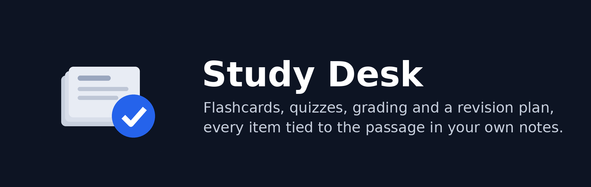

<p align="center"></p>

# Study Desk

Six study skills for Claude, every one of them tied to the material you give it. Flashcards, practice questions and mock exams come from your notes, slides, chapter or past paper, each item pointing to the passage it came from; grading says what was right, missing and wrong against that passage; explanations use the material's own terms first and mark anything added from outside.

**Try it first:** paste a page of your notes and type *make flashcards from this*, or *quiz me on this*.

**The rule of this desk: every question comes from the material.** Nothing is pulled from Claude's memory of a textbook and passed off as your course. Where Claude adds a fact, an example or an analogy of its own, it is labelled `from outside the material:` so you always know which is which. A wrong answer is called wrong, with the passage that shows it.

| Skill | Say | You get |
|---|---|---|
| **study-cards** | "make flashcards from this" | A table of cards with their sources, and a tab-separated block that imports straight into Anki |
| **study-quiz** | "quiz me", "am I ready?" | Recall, understanding and application questions; the key stays hidden until you answer; then each answer graded against the material and a result line to keep |
| **study-grade** | "check my answer", "is this right?" | Right, missing and wrong points with the passage for each; a score as a fraction; one next step; a card for each gap |
| **study-explain** | "I don't get this part" | The concept in the material's own words and order, then a marked analogy, then one question to check it landed, then a few cards on the concept |
| **study-plan** | "exam on the 20th, plan my revision" | A day-by-day table to your date with spaced repeats, fitted to the hours you have, with the words to type each day and a box to tick; it says what does not fit |
| **study-exam** | "mock exam" | A paper with marks and a time limit you keep yourself, then a marked result by topic and by question kind, and a result line to keep |

Every reply ends with one **Next:** line: the words to type for the next step, and the skill they reach.

## Where it runs

Everywhere: the Claude apps (web, desktop, mobile), Claude Code and Cowork. No server, no files, no tools; the skills need nothing but the conversation.

## Install

From the Claude directory: search for Study Desk. In Claude Code:

```
claude plugin marketplace add najikay/claude-study-desk
claude plugin install study-desk
```

## What it will not do

- Work without material. Ask it to quiz you on "chapter 3" with no chapter pasted and it asks for the chapter.
- Predict your grade, guess what the examiner wants, or keep time during a mock (it tells you to time yourself).
- Soften a wrong answer, or grade your wording when the question did not ask for it.

## Tests and evals

Tests that the promises are in the skills as exact sentences live on the `ci` branch and run on every push. `evals/` holds ten cases: one per skill, a Hebrew flashcard case, an Arabic quiz case, a request with no material, and "am I ready?". Every case uses the same invented lecture notes (wheel odometry) that leave some things undefined, so invention shows. Each grader checks one thing and the judge is Sonnet. `claude plugin eval .` runs them with the plugin and without it.

Checks passed with the plugin, three runs per case, Sonnet judge. The first column is the 0.1.0 figure published on 2026-10-06; the second is the same 0.1.0 skills re-run on 2026-10-13 against today's graders (two graders were corrected: the notes do give one unit, "e radians"); the third is 0.1.1 on the same graders (study-exam re-run after a network timeout, study-explain after its last fix):

| Case | 0.1.0, published 2026-10-06 | 0.1.0 control, 2026-10-13 | 0.1.1, 2026-10-13 |
|---|---|---|---|
| am-i-ready | 4/6 | 3/6 | 3/6 |
| no-material | 3/3 | 3/3 | 3/3 |
| study-cards | 9/9 | 8/9 | 8/9 |
| study-cards-hebrew | 6/6 | 6/6 | 6/6 |
| study-exam | 9/9 | 7/9 | 8/9 |
| study-explain | 5/9 | 7/9 | 6/9 |
| study-grade | 9/9 | 9/9 | 9/9 |
| study-plan | 8/9 | 9/9 | 9/9 |
| study-quiz | 9/9 | 8/9 | 7/9 |
| study-quiz-arabic | 6/6 | 6/6 | 6/6 |
| **All checks** | **68/75** | **66/75** | **65/75** |

The judge varies by about ±2 checks between runs of the same skills, so the older 68/75 is withdrawn as the headline; read the last two columns side by side. The new check that every reply ends with a Next line naming the words to type passes 28/30 with 0.1.1.

What the misses are: the explanation skill still slips some of its own reasoning before the "from outside the material" marker in some runs; the "am I ready?" quiz sometimes has a question the judge reads as an inference beyond the notes; a quiz now and then asks something the notes only imply. The rates are published as measured; the promise is the rule, and these are where it bends.

## Privacy

See [PRIVACY.md](PRIVACY.md): the plugin collects nothing and sends your material nowhere.

## Licence

Apache-2.0. Copyright 2026 Naji Kayal.
